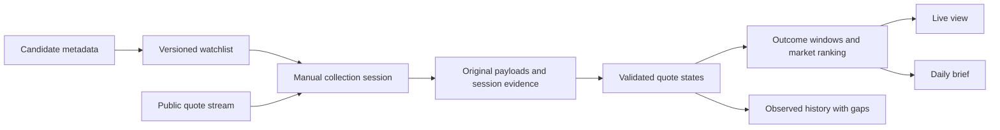

# Architecture Research

**Domain:** Session-based quote intelligence on Microsoft Fabric
**Researched:** 2026-10-21
**Confidence:** MEDIUM; no performance or runtime validation performed
**Status:** Architecture candidates for review after requirements; not a deployment plan.

This is the architecture research dimension of the GSD new-project workflow, not the project's approved solution architecture. The diagram expresses logical responsibilities and candidate dependencies. Component selection, deployment topology, schemas and data contracts, runtime/identity configuration, detailed recovery behavior, resource sizing and acceptance evidence still require design after requirements approval. Candidate build-order groups here do not approve implementation phases.

**Confirmed scope clarification:** Raw metadata ingestion covers all open markets in the AI-tag candidate set. Watchlist selection of up to 30 AI markets is a downstream transformation responsibility; this document does not prescribe its implementation.

## Standard Architecture

The reusable mental model is a boundary between observed source data, reconstructed analytical state and consumer-facing results. Raw retention enables investigation; it does not by itself prove replay, completeness or recovery.

### Component Responsibilities

| Boundary | Owns | Does not establish on its own |
|----------|------|--------------------------------|
| Candidate discovery | Provenance, pagination, snapshot scope and volume fields | AI-direct classification or completeness under an arbitrary page cap |
| Watchlist | Membership validity, vacancies, selection reason and effective intervals | Continuous coverage before the subscription begins |
| Collector | Session/asset identity, received timestamp, source payload and connection evidence | Source-delivery exactly-once guarantees |
| Raw publication | Successful input units, failure boundaries and replay inputs | Quality of a derived KPI |
| Quote reconstruction | Snapshot/delta adaptation, valid two-sided states, deduplication and transition counting | Full observation outside declared continuity |
| KPI evaluation | Event-time anchors, signed changes, eligibility and gap flags | Causal explanation, trading volume or statistical abnormality |
| Serving | Current result, as-of time, session state and history gaps | Truth merely because a visual refreshed |

## Candidate Fabric Mappings

**Candidate A: Lakehouse-centered.** Evaluate reuse of existing raw ingest and a finite notebook session, with bounded downstream updates and a compatible display. Advantage: fewer duplicate paths. Risk: buffering, processing, query visibility and display refresh may leave insufficient latency budget.

**Candidate B: Live Eventhouse path with retained raw/history.** Evaluate an upstream WebSocket client and thin adapter -> existing Eventstream custom endpoint -> Eventhouse -> Real-Time Dashboard, with retained original payload/session evidence and replayable derived history in Lakehouse where needed. Advantage: documented Fabric streaming/query/display functions and existing candidate items. Risk: more lifecycle, consistency and consumption boundaries.

Choose only after requirements and a targeted feasibility plan. Existing Eventhouse/Eventstream items are not automatically adopted. No native Polymarket connector is claimed; documented custom endpoint support concerns the protocols used to send events to Fabric.

## Architectural Patterns

### Original Payload Plus Explicit Envelope

Retain the source representation with session, asset mapping, receipt time and capture provenance. Normalize in a derived layer. Eventstream Lakehouse projection can drop fields, so any route used as raw must demonstrate fidelity, not merely carry the bronze label.

### Time and Continuity as Separate State

Event time governs market calculations; receipt/display times measure processing freshness. Connection and session intervals govern declared observation coverage. Quotes that do not change need not imply a broken connection. A reconnect snapshot begins a new trusted state and is not automatically a quote-change event.

### One KPI Contract Across Live and Replay

Define quote validity, anchor selection, transitions and ties once. If two engines are used, prove agreement against the same fixture inputs. Store and expose enough evidence to explain why a result is eligible, partial or unavailable. Reprocessing retained raw must not change raw or silently double derived counts.

## Data Flow and Build Order

1. Confirm source/business contracts and inspect existing definitions/raw before reuse.
2. Establish minimal metadata, watchlist and session evidence boundaries.
3. Produce the first end-to-end result with quality/insufficient-history states during a short session.
4. Extend correct quote reconstruction and 5/15/60-minute semantics using deterministic fixtures.
5. Add coherent daily/history views, gap presentation and replay checks.
6. Only after the full flow works, execute separately approved longer sessions for measured windows/freshness and portfolio evidence.

These are proposed dependency groups. Phase structure will be approved through the original GSD requirements/roadmap gates.

## Scaling Considerations

Initial sizing unit is 30 markets, but subscriptions and state are outcome/asset-based. Market count alone is not an event-rate or CU estimate. Measure bytes, events, outcomes, ingestion/query overhead, file counts and session duration before expansion. A quiet stream still has host and query costs; no additional paid infrastructure is assumed.

## Anti-Patterns

- Selecting Fabric components before the source and display contract is established.
- Treating raw directories, table schemas or Completed jobs as proof of correct data.
- Writing heterogeneous source events directly into a fixed schema and calling it lossless raw without checking readback.
- Using ingestion-time detection alone to evaluate windows that can change while no data arrives.
- Assuming SDK model names match raw wire fields or that every asset ID has a legacy token format.
- Claiming 60-minute live correctness from a few-minute session.

## Sources

- https://learn.microsoft.com/en-us/fabric/real-time-intelligence/event-streams/add-source-custom-app — producer protocol boundary.
- https://learn.microsoft.com/en-us/fabric/real-time-intelligence/event-streams/add-destination-lakehouse — schema projection, buffering and startup routing caveat.
- https://learn.microsoft.com/en-us/fabric/real-time-intelligence/dashboard-live-refresh — ingestion detection and fallback.
- https://docs.polymarket.com/market-data/realtime-data — SDK representations and asset identity.
- `evidence/fabric-mcp-inspection.json` — observed workspace/capacity metadata and directory inventory, not data validation.

## Knowledge Sources

- `C:/Users/sanbo/Code/fabric-agent-knowledge/wiki/data-engineering/design.md` — raw and analytical responsibility boundaries.
- `C:/Users/sanbo/Code/fabric-agent-knowledge/wiki/data-storage/gotchas.md` — publication, retention and replay limits.
- `C:/Users/sanbo/Code/fabric-agent-knowledge/wiki/event-stream-processing/prerequisites.md` — event/arrival/processing clocks.
- `C:/Users/sanbo/Code/fabric-agent-knowledge/wiki/microsoft-fabric/eventstream-ingestion-boundaries.md` — current official routing/schema limitations.
- `C:/Users/sanbo/Code/fabric-agent-knowledge/wiki/microsoft-fabric/realtime-serving.md` — rendering/ingestion freshness distinction.
