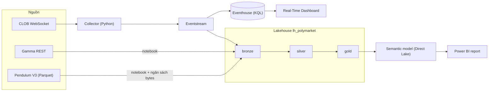

# 03 — Design Architecture

> **Dự án:** Polymarket Market Intelligence · **Phiên bản:** 2.0 (tối giản hoá từ v1) · **Ngày:** 2026-10-15
> **Business authority:** [01](01-business-problem.md) · **Source authority:** [02](02-source-research-and-decisions.md)
> **Trạng thái:** đề xuất baseline kiến trúc. Các thay đổi lớn so với v1 được liệt kê ở mục 11 và **cần bạn xác nhận**.
> **Phạm vi:** chọn thành phần, luồng dữ liệu, vận hành tối thiểu, lộ trình. Schema chi tiết ở [04](04-data-modelling.md). Quy trình xin phép trước khi ghi lên Fabric/Azure vẫn theo `AGENTS.md`.

## 1. Kiến trúc trong một trang

**Hai đường đi, mỗi đường trả lời một câu hỏi business:**

| Đường | Trả lời câu hỏi | Công cụ | Độ trễ |
|---|---|---|---|
| **Hot (live)** | "Market nào đang biến động mạnh *bây giờ*?" | Eventstream → Eventhouse (KQL) → Real-Time Dashboard | Giây → ~1 phút |
| **Cold (daily + history)** | "Hôm nay/7 ngày qua có gì nổi bật? Dữ liệu đáng tin đến đâu?" | Eventstream → Lakehouse **bronze → silver → gold** → Power BI | Phút → giờ (theo lịch) |

Ranking live chỉ được tính ở Eventhouse; tổng hợp ngày/lịch sử chỉ được tính ở Lakehouse. Không KPI nào có hai cách tính. Phần giống nhau duy nhất là bước trích quote (parse) — được kiểm tra chéo bằng test đối chiếu (mục 8, S4).

## 2. Nguyên tắc thiết kế (đứng trên vai người khổng lồ)

1. **Dùng mẫu chuẩn của Fabric:** [Medallion](https://learn.microsoft.com/en-us/fabric/onelake/onelake-medallion-lakehouse-architecture) 3 lớp (Bronze = thô, Silver = đã làm sạch, Gold = star schema cho báo cáo) và Real-Time Intelligence (Eventstream → Eventhouse → Real-Time Dashboard) cho dữ liệu stream.
2. **Một Lakehouse, nhiều schema** (`bronze`, `silver`, `gold`, `ops`) — đủ cho dự án nhỏ; không tách workspace/lakehouse theo lớp.
3. **Bronze giữ nguyên dữ liệu gốc** (payload dạng chuỗi + envelope) để luôn xử lý lại được; mọi sửa đổi logic chạy lại từ Bronze.
4. **Xử lý tăng dần theo lịch, không chạy liên tục:** Spark Structured Streaming với `trigger(availableNow=True)` + checkpoint + `MERGE` — chỉ tốn compute khi chạy, và chạy lại an toàn (idempotent).
5. **Định nghĩa KPI viết một lần** (tài liệu 01/04), mỗi KPI có một nơi tính.
6. **Đo trước khi tối ưu:** không partition, không OPTIMIZE mỗi lần ghi, không thêm dịch vụ khi chưa có số đo cho thấy cần.

## 3. Thành phần và lý do chọn

| Thành phần | Vai trò | Vì sao chọn | Đã cân nhắc và bỏ |
|---|---|---|---|
| **Collector** (Python, `asyncio`) | Giữ kết nối WebSocket, đóng gói envelope, gửi Eventstream, ghi sự kiện connect/disconnect | WebSocket cần một process chạy liên tục có tự reconnect | Fabric notebook làm nơi chạy mặc định (xem mục 6); Azure Functions/Container Apps (thêm dịch vụ) |
| **Eventstream** | Nhận stream, đệm, **phát song song tới nhiều đích** | Cách ingest stream chuẩn của Fabric; một nguồn → Eventhouse + Lakehouse | Collector ghi thẳng Delta (mất bộ đệm/fan-out); Event Hubs riêng |
| **Eventhouse + Real-Time Dashboard** | Truy vấn cửa sổ thời gian 5/15/60 phút trên stream, hiển thị live | KQL sinh ra cho bài toán này (`arg_max`, `prev()`, `bin()`); không cần Spark chạy liên tục | Tính ranking live bằng Spark rồi đẩy sang Power BI |
| **Lakehouse (medallion)** | Lưu bền Bronze/Silver/Gold dạng Delta | Chuẩn Fabric; Gold là star schema cho Power BI | Warehouse; nhiều lakehouse; thêm lớp Staging |
| **Spark notebooks** | Parse, làm sạch, dedup, tổng hợp | Test và tái sử dụng code Python tốt; làm việc trực tiếp với Delta | Dataflow Gen2/T-SQL (có thể, nhưng khó test và khó parse JSON lồng nhau) |
| **Data pipeline** | Lên lịch + tham số hoá notebook | Orchestration native, có Monitor hub | Airflow/ADF riêng |
| **Semantic model + Power BI** | Báo cáo daily/history | Direct Lake đọc Delta ở Gold; fallback Import nếu gặp hạn chế | DirectQuery qua Warehouse |
| **Git integration** | Version control cho Fabric items | Là một phần bằng chứng portfolio | — |

## 4. Luồng dữ liệu

### 4.1 Live (hot path)
1. **Collector** subscribe các token của watchlist. Mỗi message WebSocket được bọc thành *envelope*: `msg_id, session_id, connection_id, segment_no, received_at, kind, payload` (payload = chuỗi gốc, không sửa). `msg_id` được gán **trước khi gửi** và giữ nguyên khi retry. Mảng snapshot ban đầu được tách thành từng phần tử để mỗi envelope nhỏ hơn giới hạn message của Eventstream. Sự kiện điều khiển (`session_start`, `connect`, `subscribed`, `disconnect`, `reconnect`, `session_stop`) dùng cùng envelope với `kind = 'control'`; mỗi lần reconnect tăng `segment_no`.
2. **Eventstream** gửi song song tới Eventhouse (`ws_raw`) và Lakehouse (`bronze.ws_messages`). Delivery là *at-least-once* → mọi bước sau dedup theo `msg_id`.
3. **Eventhouse**: update policy parse `ws_raw` → `quotes` (3 loại message: `book`, `best_bid_ask`, `price_change`) và `segments` (từ control events).
4. **KQL functions** tính window change, ranking, quote-change count, coverage **tại thời điểm truy vấn** — không lưu kết quả ranking, nên không có "bản công bố" để sửa/revise.
5. **Real-Time Dashboard** gọi các function và tự refresh; hiển thị freshness, trạng thái phiên và nhãn `delayed` (> 120 giây không có dữ liệu mới).

**Freshness:** `ingestion_time() − received_at` (collector → Eventhouse) cộng chu kỳ refresh của dashboard; báo cáo p50/p95 theo giờ trong lần chạy 24 giờ. *Hypothesis:* đạt p95 ≤ 60 giây — chưa có số đo.

### 4.2 Daily (cold path)
1. `bronze.ws_messages` được Eventstream append liên tục.
2. **`nb_02_bronze_to_silver`** (chạy theo lịch): đọc Bronze như stream với `availableNow` + checkpoint → parse → `MERGE` vào `silver.quotes`, `silver.session_events`, `silver.connection_segments`; message lỗi vào `silver.rejected_messages`.
3. **`nb_03_gold_daily(run_date)`**: dựng các bảng Gold theo ngày bằng `replaceWhere` (chạy lại cùng ngày → cùng kết quả). Late data = chạy lại ngày bị ảnh hưởng.
4. Semantic model đọc Gold; Power BI hiển thị daily brief với trạng thái `pending / partial / complete`.

### 4.3 Metadata và watchlist
`nb_01_gamma_snapshot`: gọi Gamma (tag AI `439`) → `bronze.gamma_responses` (body gốc) → cập nhật `silver.dim_market`/`dim_outcome` → đối chiếu `config/watchlist.csv` với bộ lọc trạng thái (tài liệu 02, mục 3) và **báo lỗi nếu market trong watchlist đã đóng/không hợp lệ** (không tự thay market) → đẩy `dim_outcome` (≤ 40 dòng) sang Eventhouse. Cách đẩy chọn trong spike S3: lệnh KQL `.set-or-replace` hoặc OneLake shortcut.

### 4.4 Lịch sử V3 (stretch)
`nb_04_v3_history`: (1) đọc **footer** của file giờ → ước lượng bytes theo cột/row group; (2) **cổng ngân sách**: bỏ qua nếu `bytes_đã_dùng_hôm_nay + ước_lượng > 1 GB`; (3) tải chỉ các cột cần thiết của row group có thống kê min/max chứa market trong watchlist, qua một *reader tự viết* (file-like object gọi HTTP Range và cộng dồn bytes vào `ops.download_ledger`); (4) ghi các dòng đã lọc vào `Files/bronze/v3/...` kèm vị trí gốc (row group, row); (5) adapter đưa vào `silver.quotes` với `source = 'v3'`. Chạy thủ công, rải nhiều ngày.

## 5. Hợp đồng từng lớp

| Lớp | Nội dung | Làm | Không làm |
|---|---|---|---|
| **Bronze** | `ws_messages`, `gamma_responses`, file V3 đã lọc, `download_ledger` | Giữ payload gốc + provenance; chỉ append | Không sửa giá trị, không bỏ dữ liệu vì "chưa dùng" |
| **Silver** | `quotes`, `session_events`, `connection_segments`, `dim_market`, `dim_outcome`, `watchlist`, `rejected_messages` | Parse, ép kiểu, **đánh cờ chất lượng** (`dq_status`), dedup theo khoá, giữ lịch sử quan sát | Không tính KPI; không xoá quote lỗi (đánh cờ, giữ lại) |
| **Gold** | `dim_*`, `fact_daily_outcome`, `fact_daily_market_move`, `fact_quote_hourly` | KPI theo ngày/giờ, star schema, trạng thái báo cáo | Không che gaps; không trộn nguồn live với lịch sử |
| **ops** | `run_log`, `dq_results`, `download_ledger` | Ghi vận hành và kết quả kiểm thử | — |
| **Eventhouse** | `ws_raw`, `quotes`, `segments`, `dim_outcome` + functions | Phục vụ live | Không là nơi lưu lịch sử dài hạn |

Schema, khoá và kiểu dữ liệu chi tiết: [tài liệu 04](04-data-modelling.md).

## 6. Vận hành tối thiểu

**Collector chạy ở đâu — mặc định VM, kiểm chứng ở spike S1.** Máy local khi phát triển; một **Azure Linux VM nhỏ** (service `systemd`, tự restart) cho phiên dài và lần chạy 24 giờ. Fabric notebook là môi trường chạy job, không có cơ chế giám sát/tự khởi động lại process như một service — chỉ dùng nếu S1 cho thấy đủ ổn định. Một VM không phải high availability (chấp nhận được cho portfolio).

| Pipeline | Kích hoạt | Các bước |
|---|---|---|
| `pl_gamma_snapshot` | Đầu mỗi phiên + 1 lần/ngày | `nb_01` |
| `pl_incremental` | Mỗi 15 phút trong phiên + 1 lần sau khi phiên kết thúc | `nb_02` |
| `pl_daily` | Sau mỗi ngày có phiên | kiểm tra Silver đã xử lý xong → `nb_03` → `nb_90_maintenance` |
| `pl_history_backfill` | Thủ công | `nb_04` → `nb_02` (adapter V3) → `nb_03` (phần history) |

| Hạng mục | Baseline |
|---|---|
| **Lịch** | Phiên khai báo trước; không 24/7. Thử ngắn → ~24 giờ → kéo dài nếu đạt |
| **Monitoring** | Monitor hub (pipeline), Capacity Metrics app (cần quyền admin), bảng `ops.run_log` (job, run_id, rows_in/out, status), `ops.dq_results`, freshness trong dashboard. Không xây nền tảng monitoring riêng |
| **Chi phí** | Theo dõi riêng CU (Fabric) và credit Azure (VM). Hết phiên: tắt collector, tắt lịch pipeline. Chưa đặt trần CU/VM SKU khi chưa đo |
| **Bảo trì Delta** | `nb_90_maintenance` hằng tuần: `OPTIMIZE` Bronze/Silver (Eventstream sinh nhiều file nhỏ) và `VACUUM` với retention mặc định — không rút ngắn |
| **Retention** | Lakehouse: giữ đến khi trial kết thúc, không tự xoá. Eventhouse: `ws_raw` ~7 ngày, `quotes` ~30 ngày (chỉnh sau khi đo dung lượng) |
| **Bảo mật** | Connection string của Eventstream để trong biến môi trường/file `.env` ngoài Git (hoặc Key Vault nếu có); không commit secrets; chỉ làm việc trong workspace `Polymarket-DEV` |
| **Tham số mặc định** | `stale_after_seconds = 120` · `silver_every = 15 phút` · `v3_daily_cap_bytes = 1_000_000_000` |
| **Kết thúc demo** | Dừng ingestion/compute, lưu bằng chứng (Git, video, ảnh) **trước khi trial hết hạn**; không tự xoá hay công khai dữ liệu thô |

**Môi trường:** một workspace (`Polymarket-DEV`) kết nối Git; nhánh `main` + nhánh tính năng, PR để review. Không cần dev/test/prod riêng cho portfolio. Đặt tên `snake_case`, theo [naming conventions](../reference/naming-conventions.md) của repo; đề xuất: `lh_polymarket`, `eh_polymarket`, `es_polymarket_ws`, `nb_<số>_<mục đích>`, `pl_<mục đích>`, `fn_<mục đích>` (KQL).

## 7. Idempotency, chạy lại và backfill

- **Khoá tự nhiên + `MERGE`:** quote có khoá `quote_id` ổn định → chạy lại không sinh trùng. Eventstream at-least-once được hấp thụ ở đây.
- **Gold theo ngày:** `replaceWhere date = run_date`.
- **Sửa logic parse:** sửa notebook → xoá checkpoint + bảng Silver bị ảnh hưởng → chạy lại từ Bronze. Sửa logic KPI Gold: chạy lại các ngày cần thiết.
- **Audit:** `DESCRIBE HISTORY` của Delta + `ops.run_log` là đủ; không cần bảng revision riêng.

## 8. Kiểm chứng trước khi build (spikes)

| Spike | Cần chứng minh | Đạt khi |
|---|---|---|
| **S0 Môi trường** | Tạo được Eventstream, Eventhouse, Lakehouse (schema-enabled), pipeline, Git integration; biết hạn trial/quota | Mọi item tạo được trong `Polymarket-DEV` |
| **S1 Collector** | Chạy ổn định, tự reconnect, ghi gap | Chạy ~24 giờ không can thiệp; mọi lần mất kết nối có cặp `disconnect/reconnect`; số liệu CU hoặc chi phí VM |
| **S2 Eventstream** | Envelope đi nguyên vẹn tới cả hai đích; message không vượt giới hạn; trùng lặp xử lý được | Đối chiếu số message gửi/nhận; không rơi trường |
| **S3 Eventhouse** | Update policy trích đúng quote từ 3 loại message; nạp `dim_outcome` được; đo freshness | Khớp fixture R03–R09; có p50/p95 `ingestion_time() − received_at` |
| **S4 Silver** | `availableNow` + checkpoint chạy lại idempotent; DQ rules đúng; **Silver khớp Eventhouse** trên cùng một phiên | Bộ test tài liệu 04 mục 10 qua; số quote và mid cuối mỗi outcome khớp |
| **S5 Báo cáo** | RTD refresh ổn; Direct Lake đọc được Gold | RTD hiển thị ranking + freshness; nếu Direct Lake lỗi → dùng Import |
| **S6 Ngân sách V3** | Reader tự viết đo đúng bytes; ước lượng theo footer sát thực tế | Đo trên 1–2 giờ-file; kế hoạch 7 ngày vừa trần 1 GB/ngày |

Các hành vi của nền tảng chưa kiểm trên tenant thật (độ trễ batching của Eventstream → Lakehouse, mapping kiểu Delta → KQL/SQL endpoint, hành vi Direct Lake) chỉ được coi là đã chắc chắn **sau** spike tương ứng.

## 9. Lộ trình triển khai

| Mốc | Nội dung | Hoàn thành khi | Có thể cắt? |
|---|---|---|---|
| **M0 Setup** | Workspace, Git, khung repo, S0, watchlist đã duyệt | Item tạo được; `config/watchlist.csv` có commit review | Không |
| **M1 Live MVP** | Collector → Eventstream → Eventhouse → RTD ranking 5/15/60 (S1–S3) | Phiên 1 giờ cho ra ranking + freshness + cờ gap | Không |
| **M2 Lakehouse core** | Bronze + Silver, DQ tests, `run_log` (S4) | Silver khớp Eventhouse cho một phiên | Không |
| **M3 Daily** | Gold + semantic model + daily brief (S5) | Daily brief từ phiên M2 với trạng thái đúng | Không |
| **M4 History** *(stretch)* | V3 downloader có cổng ngân sách → Silver → Gold hourly (S6) | Trang history hiển thị ≥ vài ngày, ghi rõ coverage | **Có** — MVP vẫn trọn vẹn |
| **M5 Hardening** | Chạy 24 giờ, README, video, xuất Git, ghi chú CU, dọn dẹp | Đủ Definition of Done ở tài liệu 01 mục 8 | Không |

## 10. Cố ý **không** làm (tránh over-engineering)

- Không 4 lớp Raw/Staging/Cleaned/Curated; không Warehouse/Azure SQL/Databricks/Container Apps.
- Không Structured Streaming chạy liên tục xuyên nhiều lớp; không Change Data Feed, không Materialized Lake View trong đường đi chính.
- Không đưa KPI live qua Lakehouse rồi shortcut sang Eventhouse (thêm độ trễ và phụ thuộc).
- Không bảng `policy_versions`, `observation_intervals`, `publication_batches/events`, khoá hash SHA-256 nhiều tầng, revision cho từng kết quả.
- Không dùng REST `/book` trong pipeline; không dev/test/prod; không partition mặc định; không monitoring platform riêng.

**Khi nào mới nâng cấp:** thêm nhiều nguồn/watchlist lớn hơn đáng kể, có người dùng thật cần SLA, hoặc cần audit kết quả công bố — lúc đó mới cân nhắc revision/publication, nhiều môi trường hoặc streaming liên tục.

## 11. Thay đổi so với v1 — cần xác nhận

| # | Thay đổi | Lý do |
|---|---|---|
| 1 | **4 lớp → 3 lớp Bronze/Silver/Gold** (+ schema `ops`); gộp Staging và Cleaned vào Silver | Đúng mẫu medallion chuẩn; dữ liệu nhỏ (~vài chục KB/s) không cần thêm lớp |
| 2 | **Hot path: Eventstream → Eventhouse trực tiếp**, song song với Bronze (v1: Curated → shortcut → Eventhouse) | Chính v1 ghi: MLV tối thiểu 5 phút, Eventhouse OneLake availability batching tối thiểu 5 phút → khó chứng minh mục tiêu 1 phút qua chuỗi Lakehouse. Đổi lại phải chấp nhận ~30 dòng logic parse ở hai nơi, được kiểm tra chéo bằng S4 |
| 3 | **Spark `availableNow` theo lịch** thay vì Structured Streaming chạy liên tục qua 4 lớp | Rẻ, đơn giản, idempotent; hợp với việc chạy theo phiên |
| 4 | **Collector mặc định VM**, notebook là phương án dự phòng | Notebook không phải nơi host service chạy dài; vẫn kiểm chứng bằng S1 |
| 5 | **Bỏ revision/publication audit** | Ranking live tính khi đọc; Gold chạy lại idempotent; Delta history đủ audit |
| 6 | Bỏ REST `/book` khỏi pipeline; PMXT bị loại | Reconnect WS đã có snapshot; PMXT không phủ giai đoạn cần dùng |

Nếu bạn muốn giữ quyết định #3 của v1 ("một dòng tuần tự qua các lớp, không nhánh live độc lập"), phương án thay thế là thay Eventhouse bằng Spark + Power BI cho live — đơn giản hơn về số loại item nhưng nặng CU hơn và khó đạt freshness 1 phút.

## 12. References

- [Medallion lakehouse architecture trong Fabric](https://learn.microsoft.com/en-us/fabric/onelake/onelake-medallion-lakehouse-architecture) · [Training: implement medallion in Fabric](https://learn.microsoft.com/en-us/training/modules/describe-medallion-architecture/).
- Structured Streaming: [common patterns](https://learn.microsoft.com/fabric/data-engineering/structured-streaming-common-patterns) · [best practices](https://learn.microsoft.com/fabric/data-engineering/structured-streaming-best-practices).
- Eventstream: [overview](https://learn.microsoft.com/fabric/real-time-intelligence/event-streams/overview) · [custom endpoint](https://learn.microsoft.com/fabric/real-time-intelligence/event-streams/add-source-custom-app) · [Lakehouse destination](https://learn.microsoft.com/fabric/real-time-intelligence/event-streams/add-destination-lakehouse) · [consumption](https://learn.microsoft.com/fabric/real-time-intelligence/event-streams/monitor-capacity-consumption).
- Real-Time Intelligence: [Real-Time Dashboard sources](https://learn.microsoft.com/fabric/real-time-intelligence/dashboard-supported-data-sources) · [live refresh](https://learn.microsoft.com/fabric/real-time-intelligence/dashboard-live-refresh) · [KQL OneLake shortcuts](https://learn.microsoft.com/fabric/real-time-intelligence/onelake-shortcuts).
- Power BI: [Direct Lake](https://learn.microsoft.com/fabric/fundamentals/direct-lake-how-it-works) · [SQL endpoint sync](https://learn.microsoft.com/fabric/data-engineering/sql-analytics-endpoint-metadata-sync).
- Collector: [Python notebooks](https://learn.microsoft.com/fabric/data-engineering/using-python-experience-on-notebook) · [notebook limits](https://learn.microsoft.com/fabric/data-engineering/notebook-limitation) · [Azure VM billing states](https://learn.microsoft.com/azure/virtual-machines/states-billing).
- Giới hạn cần nhớ: Eventstream at-least-once, retention hữu hạn, giới hạn kích thước message; MLV time-based refresh tối thiểu 5 phút; Eventhouse OneLake availability batching tối thiểu 5 phút — kiểm tra lại giá trị hiện hành khi build.