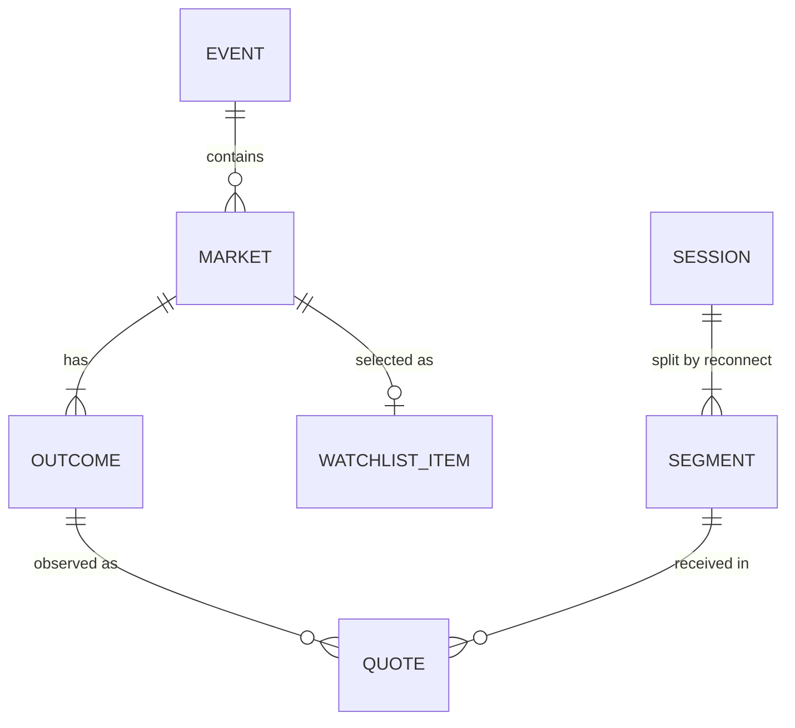

# 04 — Data Modelling

> **Dự án:** Polymarket Market Intelligence · **Phiên bản:** 2.0 (tối giản hoá từ v1) · **Ngày:** 2026-10-15
> **Business authority:** [01](01-business-problem.md) · **Source authority:** [02](02-source-research-and-decisions.md) · **Architecture authority:** [03](03-architecture-design.md)
> **Trạng thái:** thiết kế đề xuất để review; chưa phải schema đã triển khai.
> **Phạm vi:** conceptual → logical → physical (Delta/KQL), quy tắc tính KPI, kiểm thử chất lượng. Không chứa DDL chạy được; các đoạn KQL là *phác thảo* để kiểm chứng ở spike S3.

## 1. Mục tiêu và nguyên tắc

Mô hình phải trả lời được: **đã quan sát gì, cho outcome nào, lúc nào, trong đoạn kết nối nào, có đủ điều kiện tính KPI không**.

1. **Grain rõ ràng** cho mọi bảng (một dòng nghĩa là gì).
2. **Giữ dữ liệu quan sát chi tiết** ở Silver; KPI chỉ tính ở Gold/Eventhouse.
3. **ID luôn là `STRING`; giá luôn là `DECIMAL`** — không qua float.
4. **Thiếu ≠ 0.** Giá trị không có là `NULL` kèm lý do.
5. **Đánh cờ, không xoá:** quote lỗi vẫn lưu với `dq_status`, chỉ bị loại khỏi KPI.
6. **Join theo ID**, không theo question, slug, label hay timestamp.
7. PK/FK là ràng buộc *logic* — Delta không tự enforce, nên kiểm bằng test (mục 10).

## 2. Mô hình khái niệm



| Entity | Ý nghĩa |
|---|---|
| **Event** | Nhóm market của Gamma; không phải sự kiện quote |
| **Market** | Một câu hỏi + điều kiện resolution; là đơn vị của watchlist và ranking |
| **Outcome** | Một lựa chọn gắn với một token ID (Yes/No…); KPI tính ở mức này. Không suy `No = 1 − Yes` |
| **Watchlist item** | Market được duyệt vào danh sách theo dõi (≤ 20), có ngày hiệu lực |
| **Session** | Một phiên thu live đã khai báo (bắt đầu → kết thúc) |
| **Segment** | Một đoạn kết nối liên tục trong phiên; mỗi lần reconnect mở segment mới |
| **Quote** | Một lần đọc được (best bid, best ask) của một outcome từ book, BBA, `price_change` hoặc dòng V3 |

## 3. Quy ước chung

### 3.1 Khoá và định danh

| Khoá | Định nghĩa | Ghi chú |
|---|---|---|
| `market_id` | Gamma market ID (`STRING`) | Khác `condition_id` |
| `condition_id` | `0x` + 64 ký tự hex thường (`STRING`) | V3: đổi từ binary sang hex |
| `outcome_id` | Token ID dạng số thập phân chuẩn hoá, ≤ 78 chữ số (`STRING`) | V3: 32 byte big-endian → số thập phân. Label/index không đủ làm khoá |
| `session_id` | `s_<UTC yyyymmddThhmmssZ>` do collector sinh | |
| `segment_no` | `INT`, bắt đầu từ 1, +1 mỗi lần reconnect | Khoá đoạn = (`session_id`, `segment_no`) |
| `msg_id` | `<session_id>-<seq 9 chữ số>`; gán **trước khi gửi**, giữ nguyên khi retry | Khoá idempotency của Bronze WS |
| `quote_id` | `<source>:<source_record_id>#<item_idx>` | WS: `ws:<msg_id>#<i>`; V3: `v3:<object_key>@<row_group>:<row>#0`. Ổn định, độc lập với parser |

Quote trùng *biểu diễn* (BBA và `price_change` cùng mô tả một trạng thái) là **hai** `quote_id` khác nhau và đều được giữ; chúng được xử lý bằng cách đếm theo *đổi trạng thái* (mục 8), không bằng DISTINCT. `(timestamp, hash)` **không** phải khoá duy nhất.

### 3.2 Kiểu dữ liệu (Spark/Delta)

| Loại | Kiểu | Quy tắc |
|---|---|---|
| ID, khoá, văn bản | `STRING` | Không qua float |
| Giá: `best_bid/ask`, `mid_price`, `spread`, `price_change` | `DECIMAL(12,6)` | Giá nguồn có > 6 chữ số thập phân hoặc không parse được → `dq_status = invalid_number`, giữ giá trị gốc ở Bronze; **không làm tròn rồi cho qua** |
| `sequence` (V3) | `DECIMAL(20,0)` | Kiểm `0…18446744073709551615`; không dùng `BIGINT` có dấu |
| Đếm, bytes, giây | `BIGINT` | Không âm; `NULL` = chưa tính được |
| Trạng thái, lý do | `STRING` / `ARRAY<STRING>` | Từ vựng cố định (mục 5.5) |
| Thời gian | `TIMESTAMP` (UTC) | Kiểm round-trip khi sang KQL/SQL endpoint (S3, S5) |

Văn bản dài (payload, rules) chỉ ở Bronze/Silver; **không** đưa lên Gold (SQL endpoint ánh xạ `STRING` thành `varchar(8000)`).

### 3.3 Các loại thời gian

| Cột | Nghĩa |
|---|---|
| `source_ts_raw`, `source_ts_unit` | Giá trị gốc từ nguồn và đơn vị (`ms`/`us`); giữ để kiểm chứng |
| `event_ts` | Thời gian sự kiện đã chuẩn hoá; `NULL` nếu thiếu/không parse được. **Chỉ dùng cái này cho KPI** |
| `received_at` | Collector nhận message (WS); dùng đo freshness |
| `archive_received_at` | Đồng hồ của archive collector (V3, µs); không phải thời điểm dự án nhận |
| `_processed_at` | Thời điểm Silver xử lý; Gold dùng `_computed_at`, `_run_id` |

`event_ts` lệch xa `received_at` (lớn hơn `received_at` quá 5 giây) là dấu hiệu lệch đồng hồ → gắn cờ `clock_ahead`; **không** ép độ trễ âm về 0 và không thay `event_ts` bằng `received_at`.

## 4. Bronze và ops

| Bảng | Grain | Cột chính |
|---|---|---|
| `bronze.ws_messages` | Một envelope từ Eventstream | `msg_id`, `session_id`, `connection_id`, `segment_no`, `received_at`, `kind` (`ws`/`control`), `payload` (chuỗi gốc) |
| `bronze.gamma_responses` | Một lần gọi Gamma | `fetch_id`, `endpoint`, `params`, `fetched_at`, `http_status`, `body` (chuỗi gốc) |
| `Files/bronze/v3/date=…/hour=…/*.parquet` | Dòng V3 đã lọc theo watchlist | Cột nguồn đã tải + `row_group`, `row_in_group`; manifest trong `ops.download_ledger.extract_path`. Tải *cột nào* được ghi lại — **không tải ≠ null** |
| `ops.download_ledger` | Một lần gọi HTTP | `attempt_id`, `utc_date`, `purpose` (`footer`/`data`/`metadata`), `url`, `range_start/end`, `http_status`, `response_body_bytes`, `retry_no`, `is_cache_hit`, `started_at`, `ended_at`, `extract_path` |
| `ops.run_log` | Một lần chạy job | `run_id`, `job_name`, `run_date`, `started_at`, `ended_at`, `status`, `rows_in`, `rows_out`, `rows_rejected`, `rows_ignored`, `notes` |
| `ops.dq_results` | Một kiểm tra | `run_id`, `check_name`, `scope`, `status` (`pass`/`warn`/`fail`), `failed_rows`, `checked_at`, `details` |

Ngân sách V3: số bytes ngày = `SUM(response_body_bytes)` theo `utc_date` trong ledger, **gồm** metadata, footer, lỗi, tải dở, retry; `is_cache_hit = true` ghi 0 byte mạng. Cổng ngân sách chạy *trước* mỗi lần tải; reader không đo/chặn được bytes thì không dùng để tải bulk.

## 5. Silver

### 5.1 `silver.quotes`
**Grain:** một quote từ một phần tử của một message (WS) hoặc một dòng (V3). **PK:** `quote_id`. Ghi bằng `MERGE` theo `quote_id`.

| Cột | Kiểu | Null | Ghi chú |
|---|---|---|---|
| `quote_id` | STRING | NN | PK, xem 3.1 |
| `source` | STRING | NN | `ws` / `v3` |
| `event_type` | STRING | NN | Loại event gốc (`book`, `best_bid_ask`, `price_change`, …) |
| `source_record_id`, `item_idx` | STRING, INT | NN | WS: `msg_id` + vị trí phần tử; V3: `object@row_group:row` + 0 |
| `session_id`, `segment_no` | STRING, INT | N | Chỉ WS; V3 không có session |
| `condition_id`, `outcome_id` | STRING | N | Từ payload; `NULL` nếu thiếu |
| `market_id` | STRING | N | Tra từ `dim_outcome`; `NULL` nếu chưa ánh xạ |
| `source_ts_raw`, `source_ts_unit` | STRING | N | Giá trị gốc |
| `event_ts` | TIMESTAMP | N | 3.3 |
| `received_at` / `archive_received_at` | TIMESTAMP | N | WS / V3 |
| `best_bid`, `best_ask` | DECIMAL(12,6) | N | |
| `mid_price`, `spread` | DECIMAL(12,6) | N | Chỉ tính khi cả hai phía hợp lệ: `(bid+ask)/2`, `ask−bid` |
| `quote_basis` | STRING | NN | `book_top` (tính từ book) hoặc `supplied_top` (nguồn cung cấp sẵn) |
| `dq_status` | STRING | NN | 5.5 |
| `dq_flags` | ARRAY<STRING> | NN | Cảnh báo không chặn: `wide_spread` (spread > 0.10, chỉ để thông tin), `clock_ahead` |
| `is_valid` | BOOLEAN | NN | `dq_status = 'ok'` |
| `bronze_ref` | STRING | NN | `msg_id` hoặc đường dẫn file V3 |
| `_processed_at` | TIMESTAMP | NN | |

### 5.2 `silver.session_events` và `silver.connection_segments`
- `session_events` — PK `event_id` (= `msg_id` của envelope control): `session_id`, `segment_no`, `event_type` (`session_start`, `connect`, `subscribed`, `disconnect`, `reconnect`, `session_stop`), `event_ts` (= `received_at`), `details` (JSON text), `_processed_at`.
- `connection_segments` — PK (`session_id`, `segment_no`): `start_ts` (lúc `subscribed`), `end_ts` (`NULL` nếu đang mở), `end_reason` (`disconnect`/`session_stop`/`NULL`). Bảng nhỏ, dựng lại từ `session_events` ở mỗi lần chạy `nb_02`.

### 5.3 Dimension và watchlist
| Bảng | PK | Cột chính |
|---|---|---|
| `silver.dim_market` | `market_id` | `event_id`, `condition_id`, `source_market_version`, `question`, `resolution_source`, cờ trạng thái (`active`, `closed`, `archived`, `accepting_orders`, `orderbook_enabled` — `NULL` = chưa biết), `created_at_src`, `closed_at_src`, `first_seen_at`, `last_seen_at`, `in_watchlist` |
| `silver.dim_outcome` | `outcome_id` | `market_id`, `outcome_index`, `outcome_label`, `source_market_version`, `mapping_status` (`ok` / `array_mismatch` / `unsupported_version`), `first_seen_at`, `last_seen_at` |
| `silver.watchlist` | `market_id` | `effective_from`, `effective_to`, `reason`, `reviewed_by`, `status` (`active`/`closed`/`removed`), `config_commit` (SHA Git của `config/watchlist.csv`) |

Dimension dùng **Type 1** (ghi đè bản mới nhất): metadata Gamma hiếm khi đổi, và từng bản chụp gốc vẫn nằm trong `bronze.gamma_responses`. Market đóng không bị xoá khỏi dimension hay lịch sử; v1 trả về mảng `clobTokenIds` → `outcome_id` theo index; phiên bản/độ dài lạ thì `mapping_status` khác `ok` và quote tương ứng thành `unmapped_outcome` — không đoán.

### 5.4 `silver.rejected_messages`
PK `msg_id`: `reason` (`malformed_json`, `unknown_shape`, `missing_field`), `payload_excerpt`, `rejected_at`, `_processed_at`. Message không tạo quote vì đúng loại (ví dụ `new_market`) **không** vào đây — chỉ đếm vào `ops.run_log.rows_ignored`. Kiểm tra bảo toàn: `rows_in = rows_out + rows_rejected + rows_ignored`.

### 5.5 Từ vựng `dq_status` (khớp điều kiện đầu tiên, theo thứ tự)

| # | Giá trị | Điều kiện |
|---|---|---|
| 1 | `bad_time` | `event_ts` thiếu, không parse được hoặc đơn vị chưa biết |
| 2 | `invalid_number` | Giá không parse được, không hữu hạn, hoặc > 6 chữ số thập phân |
| 3 | `one_sided` | Thiếu `best_bid` hoặc `best_ask` |
| 4 | `out_of_range` | Giá ngoài [0, 1] |
| 5 | `crossed` | `best_bid > best_ask` |
| 6 | `unmapped_outcome` | `outcome_id` không có trong `dim_outcome` với `mapping_status = 'ok'` |
| 7 | `ok` | Còn lại |

Spread rộng vẫn là `ok` (chỉ gắn cờ); không dùng `last_trade_price` thay thế.

## 6. Gold — star schema cho Power BI

### 6.1 Dimension
- `gold.dim_date` — `date_key` (INT `yyyymmdd`), `date_utc`, năm/quý/tháng/ngày. Ngày có trong bảng không nghĩa là có dữ liệu.
- `gold.dim_market` — `market_id`, `question`, `event_id`, `is_closed`.
- `gold.dim_outcome` — `outcome_id`, `market_id`, `outcome_label`, `outcome_index`, `market_question` (phi chuẩn hoá để làm slicer).

### 6.2 Fact
Mọi fact có `_run_id`, `_computed_at`; ghi bằng `replaceWhere` theo ngày. Chỉ dùng quote `is_valid`.

**`gold.fact_daily_outcome`** — grain: `outcome_id` × `date_key` (nguồn `ws`).
`first_event_ts`, `last_event_ts`, `first_mid`, `last_mid`, `min_mid`, `max_mid` (*observed*, không phải open/close/high/low cả ngày), `valid_quote_count`, `invalid_quote_count`, `quote_change_count`, `declared_seconds`, `observed_seconds`, `gap_seconds`, `report_status`.
- `declared_seconds`: tổng thời lượng phiên đã khai báo trong ngày UTC; `observed_seconds`: hợp các khoảng quan sát của outcome (mục 8.4); `gap_seconds = declared − observed`.
- `report_status`: `pending` (có phiên chưa kết thúc hoặc Silver chưa xử lý xong) → `partial` (đã xử lý nhưng còn gap hoặc phiên dừng bất thường) → `complete` (đã xử lý, không gap trong phạm vi khai báo). "Complete" không có nghĩa đủ 24 giờ.

**`gold.fact_daily_market_move`** — grain: `market_id` × `date_key` × `window_minutes` ∈ {5, 15, 60}.
Đánh giá tại các mốc T cách nhau 5 phút (UTC) trong khoảng đã quan sát của ngày; mỗi (outcome, T, W) tính theo mục 8; mỗi market lấy outcome và mốc T có |thay đổi| lớn nhất. Cột: `peak_target_ts`, `winner_outcome_id`, `price_change` (có dấu), `abs_price_change`, `start_ts`, `start_mid`, `end_ts`, `end_mid`, `has_gap`, `eligible_target_count`, `move_status` (`ok` / `no_eligible_window`).

**`gold.fact_quote_hourly`** — grain: `outcome_id` × `hour_start_utc` × `source` (`ws`/`v3`).
`date_key`, `point_count`, `first_mid`, `last_mid`, `min_mid`, `max_mid`, `last_spread`, `quote_change_count` và `observed_seconds` (**chỉ `ws`; `NULL` với `v3`** vì chưa chứng minh được liên tục). Dòng `v3` chỉ là điểm giá lịch sử quan sát được: không nội suy, không điền số 0 trước khi market tồn tại.

### 6.3 Semantic model (Power BI)

| Quan hệ | Hướng |
|---|---|
| `dim_market[market_id]` → `dim_outcome[market_id]` | 1:N, một chiều |
| `dim_outcome[outcome_id]` → `fact_daily_outcome`, `fact_quote_hourly` | 1:N, một chiều |
| `dim_market[market_id]` → `fact_daily_market_move` | 1:N, một chiều |
| `dim_date[date_key]` → mọi fact | 1:N, một chiều (theo ngày sự kiện UTC, không theo ngày công bố) |

Không quan hệ hai chiều, không fact-to-fact; ẩn các khoá kỹ thuật. Mặc định **Direct Lake**; lỗi/hạn chế thì dùng Import (S5).

| Trường/measure | Cách tổng hợp |
|---|---|
| Mid, spread, price change, thứ hạng | **Không cộng** — hiển thị giá trị của ngữ cảnh đã lọc (MIN/MAX/`SELECTEDVALUE`); xếp hạng đã tính sẵn, BI không tính lại |
| `quote_change_count`, `observed_seconds`, `gap_seconds` | Cộng được trên các khoảng **không chồng lấn** cùng nguồn (ngày, giờ); không cộng các cửa sổ trượt chồng nhau |
| Coverage % | `SUM(observed_seconds) / SUM(declared_seconds)`; không lấy trung bình các phần trăm |
| first/last/min/max ngày | Gắn nhãn *observed*; không ghép nhiều phiên thành "lợi suất cả ngày" |
| `report_status` | Hiển thị nguyên trạng, không tính lại |
| Dữ liệu thiếu | Hiện "không có dữ liệu"; không `COALESCE` về 0 |

Power BI "Fixed decimal" chỉ có 4 chữ số thập phân, trong khi mid có thể có 5: chỉ **hiển thị** (định dạng 3–4 chữ số); so sánh/xếp hạng luôn dùng giá trị Delta đã tính sẵn.

## 7. Eventhouse (đường live)

| Đối tượng | Nội dung |
|---|---|
| `ws_raw` | Cột như `bronze.ws_messages`; retention ~7 ngày |
| `quotes` | `quote_id`, `event_type`, `session_id`, `segment_no`, `outcome_id`, `event_ts`, `received_at`, `best_bid`, `best_ask`, `mid_price`, `spread`, `dq_status`, `is_valid`; nạp bằng **update policy** từ `ws_raw`; retention ~30 ngày. Dùng **cùng quy tắc parse và `dq_status`** như Silver |
| `session_events` | Từ các envelope `kind = 'control'` qua update policy |
| `dim_outcome` | `outcome_id`, `market_id`, `market_question`, `outcome_label`, `outcome_index` (≤ 40 dòng) |
| Functions | `fn_segments()`, `fn_anchor(at)`, `fn_window_change(W)`, `fn_market_ranking(W)`, `fn_change_count(W)`, `fn_freshness()` |

*Phác thảo KQL (rút gọn, kiểm chứng ở S3):*

```kql
.create-or-alter function fn_segments() {
    session_events
    | summarize start_ts = minif(event_ts, event_type == "subscribed"),
                end_ts   = maxif(event_ts, event_type in ("disconnect", "session_stop"))
      by session_id, segment_no
}

// Mốc giá tại thời điểm `at`: quote hợp lệ gần nhất, và đoạn kết nối của nó còn "sống" tại `at`
.create-or-alter function fn_anchor(at:datetime) {
    quotes
    | where is_valid and event_ts <= at
    | summarize arg_max(event_ts, mid_price, session_id, segment_no) by outcome_id
    | join kind=inner fn_segments() on session_id, segment_no
    | where isnull(end_ts) or end_ts >= at
    | project outcome_id, anchor_ts = event_ts, anchor_mid = mid_price,
              seg_key = strcat(session_id, "#", segment_no)
}

.create-or-alter function fn_window_change(W:int, T:datetime = datetime(null)) {
    let t = iff(isnull(T), now(), T);
    let s = fn_anchor(t - 1m * W) | project outcome_id, start_ts = anchor_ts, start_mid = anchor_mid, start_seg = seg_key;
    let e = fn_anchor(t)          | project outcome_id, end_ts = anchor_ts, end_mid = anchor_mid, end_seg = seg_key;
    s | join kind=inner e on outcome_id
    | extend price_change = end_mid - start_mid, abs_change = abs(end_mid - start_mid),
             has_gap = (start_seg != end_seg), window_minutes = W, as_of = t
}

.create-or-alter function fn_market_ranking(W:int) {
    fn_window_change(W)
    | join kind=inner dim_outcome on outcome_id
    | order by market_id asc, abs_change desc, outcome_index asc          // tie-break trong market
    | extend rn = row_number(1, market_id != prev(market_id))
    | where rn == 1
    | order by abs_change desc, market_id asc                              // tie-break giữa các market
    | extend market_rank = row_number()
}
```

Để dashboard hiện *lý do* không có hạng (`no_start_anchor`, `no_end_anchor`), dùng `join kind=rightouter` với `dim_outcome` thay cho `inner` và điền `window_status`. Freshness: `quotes | extend lag = ingestion_time() - received_at | summarize percentiles(lag, 50, 95) by bin(received_at, 5m)`. Thứ hạng chỉ lấy `top 3` ở tầng hiển thị; các dòng còn lại và dòng no-rank vẫn được giữ.

## 8. Logic KPI (dùng chung cho KQL và Spark)

### 8.1 Mốc giá (anchor)
`anchor(outcome, at)` = quote `is_valid` có `event_ts ≤ at` gần nhất, **với điều kiện segment của quote đó chưa kết thúc trước `at`** (`end_ts` rỗng hoặc ≥ `at`). Không dùng quote sau `at`; không điền ngược. Quote đầu tiên của một segment (book snapshot sau reconnect) là *baseline* cho đoạn đó.

### 8.2 Price change theo cửa sổ
Với W ∈ {5, 15, 60}: `start = anchor(T − W)`, `end = anchor(T)`. Cả hai tồn tại → `price_change = end_mid − start_mid`. Thiếu một trong hai → cửa sổ đó không đủ điều kiện (lý do: `no_start_anchor`/`no_end_anchor`); các cửa sổ khác vẫn độc lập. `has_gap = (segment của start ≠ segment của end)` — vẫn xếp hạng được nhưng phải hiển thị cờ gap.

### 8.3 Quote-change count
Trong `(T − W, T]`, lấy quote `is_valid` của outcome, bắt đầu từ anchor `T − W` làm *baseline*; sắp theo (`session_id`, `segment_no`, `event_ts`, `received_at`). Một **thay đổi** = dòng có (`best_bid`, `best_ask`) khác dòng liền trước **cùng outcome và cùng segment**.
- BBA + `price_change` cùng trạng thái → trạng thái bằng nhau → không đếm lần hai.
- `A → B → A` = 2 thay đổi; level đổi nhưng top không đổi = 0.
- Dòng đầu của segment mới (snapshot sau reconnect) là baseline, không đếm.
- Có gap trong cửa sổ → `count_status = partial`. `0` chỉ được coi là "không đổi" khi cửa sổ có baseline và không gap.
- Giới hạn đã biết: hai quote cùng `event_ts` nhận đảo thứ tự có thể lệch ±1 — chấp nhận, ghi chú trong kết quả kiểm thử.

### 8.4 Coverage
Khoảng quan sát của outcome trong một segment = `[event_ts của quote hợp lệ đầu tiên, min(end_ts, T)]`. `coverage(W) = độ dài giao của [T−W, T] với các khoảng quan sát / W`; `gap = W − phần giao`. Coverage không suy ra từ số lượng quote; PONG chỉ chứng minh kết nối sống, không chứng minh đủ dữ liệu.

### 8.5 Ranking và đồng hạng
Mỗi market lấy outcome có `abs_change` lớn nhất trong các outcome đủ điều kiện; **đồng hạng giữa các outcome của cùng market → `outcome_index` nhỏ hơn** (Yes/No thường có |thay đổi| gần như bằng nhau, nên quy tắc này hay được dùng); xếp market theo `abs_change` giảm dần, **đồng hạng → `market_id` tăng dần**. Không outcome nào đủ điều kiện → market không có hạng nhưng vẫn có dòng trạng thái. Chấp nhận < 3 market đủ điều kiện.

### 8.6 Freshness và trạng thái live
`ingest_lag = ingestion_time() − received_at`; hiển thị `data as of` (= T) và `last_received_at`. `delayed` khi `now() − max(received_at) > stale_after_seconds` (mặc định 120); `session ended` khi có `session_stop`. Không cập nhật giả các mốc thời gian.

## 9. Ánh xạ nguồn → `quotes`

| Loại message | Cách lấy `best_bid`/`best_ask` | Số quote |
|---|---|---|
| `book` (WS; V3 book) | `max(bids.price)`, `min(asks.price)` trên các mức `size > 0` — **không** dựa thứ tự phần tử | 1 / phần tử mảng |
| `best_bid_ask` (WS; V3 BBA) | Trường `best_bid`, `best_ask` (chuỗi rỗng → `NULL`); `quote_basis = supplied_top` | 1 |
| `price_change` (WS; V3) | Với mỗi phần tử của `price_changes`: `best_bid`, `best_ask` của asset đó | 1 / asset |
| Loại khác (`new_market`, …) | Không phải quote | 0 → đếm vào `rows_ignored` |

`size = 0` nghĩa là xoá mức giá, không phải giao dịch. Chỉ top-of-book được dùng; **không** dựng lại toàn bộ độ sâu và không có KPI volume/size.

## 10. Kiểm thử chất lượng dữ liệu

Fixture lấy từ dữ liệu khảo sát (R03–R09) đặt trong `tests/fixtures/`; chạy bằng `pytest` hoặc notebook `nb_test_silver`, ghi kết quả vào `ops.dq_results`. **Kiểm thử fail → notebook báo lỗi → pipeline fail** (không chỉ ghi cảnh báo rồi tiếp tục).

| ID | Tình huống | Kỳ vọng |
|---|---|---|
| DM-01 | Cùng message được gửi lại (at-least-once/retry) | Một `quote_id`; count không tăng |
| DM-02 | Mảng `book` ban đầu; `price_change` nhiều asset | Mỗi asset một quote; `quote_id` ổn định; truy về đúng message |
| DM-03 | Version lạ; mảng `outcomes`/`clobTokenIds` lệch độ dài | `mapping_status ≠ ok`; quote `unmapped_outcome`; không đoán |
| DM-04 | Token uint256, `sequence` UINT64 lớn nhất, ID binary V3 | Round-trip chính xác; không float/tràn số |
| DM-05 | Null, chuỗi rỗng, 0, crossed, ngoài [0,1], spread rộng | Đúng `dq_status`; thiếu ≠ 0; spread rộng vẫn `ok` + cờ |
| DM-06 | bid 0.1234, ask 0.1235; giá > 6 chữ số thập phân | mid = 0.123450 chính xác; quá chính xác → `invalid_number`, không làm tròn |
| DM-07 | BBA + `price_change` cùng trạng thái; `A→B→A`; top không đổi | Không đếm trùng; A→B→A = 2; không đổi top = 0 |
| DM-08 | Cùng timestamp, nhận đảo thứ tự | Không dùng timestamp+hash làm khoá; ghi nhận giới hạn ±1 |
| DM-09 | Quote đầu sau T; hai mốc đủ tin cậy nhưng có gap giữa | Không điền ngược; vẫn xếp hạng, `has_gap`, count `partial`; 5 phút đủ không làm 60 phút đủ |
| DM-10 | Im lặng + PONG; disconnect/reconnect | Không coi là stale hay "0 thay đổi"; reconnect = segment mới; snapshot không đếm là thay đổi |
| DM-11 | `event_ts` thiếu; ms so với µs; thời gian lùi | `bad_time` hoặc đổi đơn vị đúng; không thay bằng `received_at` |
| DM-12 | Chạy lại Silver/Gold với cùng input | Kết quả giống hệt, không trùng dòng |
| DM-13 | Market đóng; không outcome đủ điều kiện; đồng hạng | Không tự thay market; vẫn có dòng trạng thái; tie-break theo 8.5 |
| DM-14 | Phiên chỉ một phần ngày; nhiều phiên | `report_status` đúng; coverage = hợp các khoảng; V3 không lấp gap của live |
| DM-15 | Reader V3: lỗi, retry, cache, chạm trần | Ledger đúng bytes thực; cache không tính; chạm trần → dừng, không tải toàn file |
| DM-16 | JSON hỏng, shape lạ | Vào `rejected_messages`; `rows_in = out + rejected + ignored` |
| DM-17 | **Đối chiếu Eventhouse ↔ Silver cùng một phiên** | Số quote hợp lệ và mid cuối mỗi outcome khớp |
| DM-18 | Kiểm ràng buộc logic | `quote_id` duy nhất; PK các fact duy nhất; `dim_outcome.market_id` ∈ `dim_market`; fact không có outcome mồ côi |

Đây là đặc tả kiểm thử, **chưa chạy**; chưa có bằng chứng đạt freshness 1 phút hay tương thích kiểu dữ liệu giữa Delta, KQL và Power BI cho tới khi spike tương ứng xong.

## 11. Truy vết yêu cầu → mô hình

| Yêu cầu (01/02/03) | Đáp ứng bởi |
|---|---|
| Watchlist ≤ 20 market đã duyệt | `silver.watchlist` (+ `config/watchlist.csv` trong Git) |
| KPI theo outcome; ranking theo market 5/15/60 | `quotes` → `fn_market_ranking` (live); `fact_daily_market_move` (ngày) |
| Giải thích outcome tạo hạng, dấu, hai mốc giá | `winner_outcome_id`, `start/end_ts`, `start/end_mid` |
| Hợp lệ số ≠ độ tin cậy ≠ coverage | `dq_status` + `has_gap` + coverage riêng |
| Gaps/reconnect/outcome yên tĩnh | `session_events`, `connection_segments`, mục 8.1–8.4 |
| Daily observed tách khỏi lịch sử | `fact_daily_outcome` (`ws`) vs `fact_quote_hourly` (`source = v3`) |
| ID/decimal/ms-µs/UINT64 chính xác | Mục 3.1–3.3, DM-04, DM-06 |
| Freshness 1 phút trong phiên | Mục 8.6, `fn_freshness`, `received_at`/`ingestion_time()` |
| Không mất dữ liệu âm thầm | Bronze giữ gốc; `rejected_messages`; bảo toàn `rows_in` |
| Trần 1 GB/ngày cho V3 | `ops.download_ledger` + cổng ngân sách, DM-15 |

## 12. Giả định còn mở

| Nội dung | Ghi chú |
|---|---|
| Ngữ nghĩa/độ chính xác `event_ts` của nguồn | Đã có đơn vị (ms/µs); độ chính xác đồng hồ ❓ — lọc bằng `bad_time`/`clock_ahead` |
| Thứ tự khi cùng `event_ts` | Dùng `received_at` làm tie-break; sai lệch ±1 count được chấp nhận |
| Nạp `dim_outcome` sang Eventhouse | `.set-or-replace` hay OneLake shortcut — chọn ở S3 |
| Kiểu dữ liệu Delta → KQL/SQL endpoint, hành vi Direct Lake | Chỉ coi là chắc chắn sau S3/S5 |
| Ngưỡng `wide_spread` (0.10) và `stale_after_seconds` (120) | Tham số mặc định, chỉnh sau khi đo |
| Retention Eventhouse/Lakehouse | Chốt sau khi đo dung lượng, trước lần chạy dài |
| Coverage V3 cho watchlist | Báo cáo coverage thực; có thể cắt M4 khỏi MVP |

## Thay đổi so với v1

- Từ 559 dòng xuống ~290: mô hình hoá **3 lớp** (v1: 4 lớp, ~30 bảng) → ~10 bảng Silver/ops, 3 dimension, 3 fact.
- **Bỏ:** `policy_versions`, `observation_intervals`, `capture_events`, `historical_scopes`, `scope_dimensions`/`scope_statuses`, `publication_batches/events`, result revisions, `_input_versions` JSON, khoá SHA-256 length-framed, serving projection `*_units_e10`, các nhóm cột freshness-input/coverage-JSON.
- **Đơn giản hoá:** coverage tính trực tiếp từ `quotes` + `connection_segments`; late data → chạy lại idempotent; đồng hạng, ngưỡng delayed, định nghĩa anchor đã chốt thay vì để `policy_pending`.
- **Giữ nguyên tinh thần:** exact ID/decimal, thiếu ≠ 0, đánh cờ không xoá, tách các loại thời gian, BBA + delta không đếm đôi, reconnect không bù lịch sử, ngân sách bytes thực.
- 22 bài kiểm thử DM-01…22 gộp thành 18 (mục 10), thêm đối chiếu Eventhouse ↔ Silver.

## 13. References

- [Medallion architecture trong Fabric](https://learn.microsoft.com/en-us/fabric/onelake/onelake-medallion-lakehouse-architecture) — Gold nên là star schema.
- [Lakehouse schemas](https://learn.microsoft.com/fabric/data-engineering/lakehouse-schemas) · [Data types / SQL endpoint mapping](https://learn.microsoft.com/fabric/data-warehouse/data-types) · [SQL analytics endpoint](https://learn.microsoft.com/fabric/data-engineering/lakehouse-sql-analytics-endpoint#limitations).
- [Star schema cho Power BI](https://learn.microsoft.com/power-bi/guidance/star-schema) · [Direct Lake](https://learn.microsoft.com/fabric/fundamentals/direct-lake-develop) · [Power Query data types](https://learn.microsoft.com/power-query/data-types).
- [KQL OneLake shortcuts](https://learn.microsoft.com/fabric/real-time-intelligence/onelake-shortcuts).
- Kiến thức nền: *Fundamentals of Data Engineering* (Reis & Housley) — chương 3 (kiến trúc), chương 8 (modelling, transformation); các trang đã đối chiếu trong v1 về grain, conformed dimension, streaming data modelling.
- Platform behaviours chưa kiểm trên tenant thật đều là giả định cho tới khi spike tương ứng ở tài liệu 03 mục 8 hoàn tất.